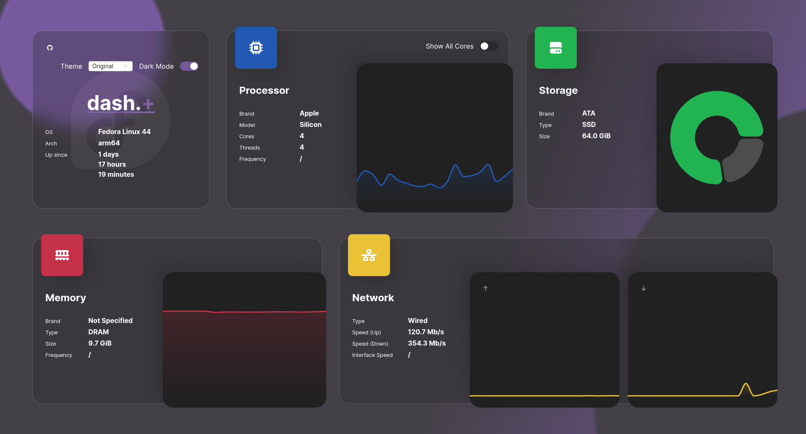
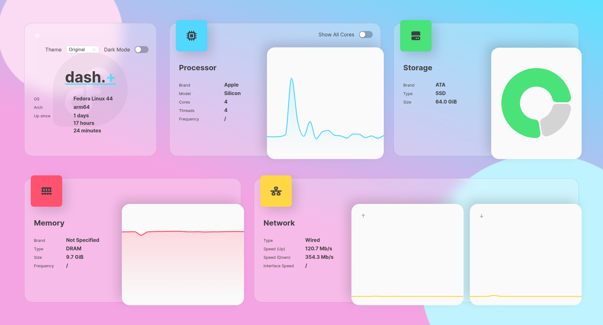

<h1 align="center">dash.+</h1>

<p align="center">
  <b>dash.+</b> (<b>dashdotplus</b>) is a modern server dashboard,
  running on the latest tech, designed with glassmorphism in mind.
  It is intended to be used for smaller VPS and private servers.
</p>

<p align="center">
  A feature-focused fork of
  <a href="https://github.com/MauriceNino/dashdot" target="_blank">dashdot</a>
  by <a href="https://github.com/MauriceNino" target="_blank">Maurice Guttenberger</a>.
</p>

<p align="center">
  <a href="https://github.com/malikons/dashdotplus/actions/workflows/deploy.yaml?branch=main" target="_blank">
    
  </a>
</p>

## What this fork adds

| Feature | Summary |
| --- | --- |
| [Containers widget](#containers-widget) | Per-container CPU, memory, network and disk I/O. On by default; needs the Docker socket. |
| [Board detection](#improved-board-detection) | Real hardware identity on Raspberry Pi and other SBCs — no `DASHDOT_OVERRIDE_*` needed. |
| [Themes](#themes) | Three dashboard themes — the original glass look, an htop-style terminal look, and Windows 98 — switchable at runtime. |

Everything else stays upstream-compatible: the same widgets, the same
`DASHDOT_*` environment configuration, and the same default appearance.

## Preview

| Dark-Mode | Light-Mode |
| --- | --- |
|  |  |

## Documentation

The full documentation lives in this repository under
[`apps/docs`](./apps/docs):

- [Installation Options](./apps/docs/content/docs/installation/docker.mdx)
- [Configuration Options](./apps/docs/content/docs/configuration/basic.mdx)
- [Containers Configuration](./apps/docs/content/docs/configuration/containers.mdx)
- [Contributing](./.github/CONTRIBUTING.md)
- [Changelog (upstream)](./.github/CHANGELOG.md)

## Quick Install (Docker)

Images are published by the [Deploy](https://github.com/malikons/dashdotplus/actions/workflows/deploy.yaml)
workflow to this repository's GitHub Container Registry, for both AMD64 and
ARM devices:

```bash
docker container run -it \
  -p 80:3001 \
  -v /:/mnt/host:ro \
  --privileged \
  ghcr.io/malikons/dashdotplus
```

To get more information on why which flag is needed, or if you want to use other
install options instead (`docker-compose`, or from source), have a look at the
[installation options](./apps/docs/content/docs/installation/docker.mdx).

To read more about configuration options, you can visit the
[configuration options](./apps/docs/content/docs/configuration/basic.mdx).

## Releases

**dash.+** versions independently of upstream dashdot and starts at `1.0.0`.
The two projects' numbers are unrelated — a dash.+ `1.2.0` says nothing about
a dashdot `6.3.5`.

| Tag | Meaning |
| --- | --- |
| `ghcr.io/malikons/dashdotplus:1.0.0` | A specific release |
| `ghcr.io/malikons/dashdotplus:1.0` | The newest `1.0.x` release |
| `ghcr.io/malikons/dashdotplus:latest` | The newest release |
| `ghcr.io/malikons/dashdotplus:main` | The newest commit on `main` — not a release |

Every image reports the version and commit it was built from in the dashboard,
so you can always tell what you are running. Pushes to `main` are built as
`<version>-dev.<sha>` and are never tagged `latest`, so a development build can
never be pulled by accident.

To cut a release:

```bash
# bump "version" in package.json, commit it, then:
git tag v1.1.0
git push origin main v1.1.0
```

> **First publish:** new GHCR packages are **private by default**, even when
> the repository is public. After the first build, set
> [the package's visibility to public](https://github.com/malikons/dashdotplus/pkgs/container/dashdotplus)
> once (Package settings → Change visibility), or anonymous `docker pull` from
> another machine will be denied.

## Containers Widget

This build adds an optional widget that monitors every running Docker
container — CPU, memory, network and disk I/O — in the same style as the
existing host-level widgets.

### Requirements

The widget is **on by default** and ships in the standard widget list. Unlike
the other widgets it needs read access to the Docker socket - the one mount a
stock dashdot setup does not already have:

```yaml
services:
  dash:
    image: ghcr.io/malikons/dashdotplus
    restart: unless-stopped
    privileged: true
    ports:
      - '80:3001'
    volumes:
      - /:/mnt/host:ro
      # only required for the containers widget
      - /var/run/docker.sock:/var/run/docker.sock
    environment:
      DASHDOT_WIDGET_LIST: 'os,cpu,storage,ram,network,containers'
```

Without the socket the widget shows a calm "No containers detected on this
host." — exactly the same line it shows for a host that genuinely has no
containers, so neither case looks like a fault.
If you drop `containers` from `DASHDOT_WIDGET_LIST` it is not polled, not
collected and not rendered at all — the default is
`os,cpu,storage,ram,network,containers`, so remove both the widget and the
mount if you do not want it.

A complete annotated version — including every optional containers setting and
how to switch individual widgets back off — is in
[`docker-compose.example.yml`](./docker-compose.example.yml).

### How it works

The server queries the Docker Engine HTTP API over the unix socket using Node's
built-in `http` module, so **no docker CLI and no new runtime dependency** is
needed. On every `DASHDOT_CONTAINERS_POLL_INTERVAL` (default `5000`ms) it lists
the running containers and requests their stats **in parallel** — each stats
call takes about 1s inside Docker, so parallel fetching keeps a 14-container
host at roughly 2s per poll instead of 14s.

Reported metrics:

- **CPU** — share of _total host capacity_, so all containers added together
  line up with the host `cpu` widget. (`docker stats` reports per-core numbers
  and therefore reads up to `nCPU` times higher.)
- **Memory** — cgroup working set (`usage` minus inactive file cache)
- **Network / Disk I/O** — bytes per second, derived from the cumulative
  counters of the previous poll; restarts reset counters to `0`, never negative
- Containers are listed alphabetically and paged, so charts do not reshuffle
  between polls

Cost of running it (measured on a 4-core Raspberry Pi 5 against 14 containers
at a 5s interval): about **0.17 % of one core**, with no measurable difference
in resident memory.

Full option reference: [Containers Configuration](./apps/docs/content/docs/configuration/containers.mdx)

## Improved Board Detection

Upstream derives hardware identity from DMI and SPD, both of which misreport on
single board computers. This fork reads the device tree
(`/sys/firmware/devicetree/base`), so a Raspberry Pi now reports real values
with **no `DASHDOT_OVERRIDE_*` needed**:

| Field | Upstream | This fork |
| --- | --- | --- |
| CPU brand | `Sony UK` — the PCB manufacturer, from the Pi revision code | `Broadcom` — from the SoC entry `brcm,bcm2712` |
| Memory brand | unset — soldered LPDDR has no SPD | `Raspberry Pi 5 (onboard)` — from the board model |
| Storage brand | empty on NVMe — drives expose no `VENDOR` | `SK hynix` — derived from the drive model |

The device tree only exists on ARM, so x86 hosts are unaffected: every lookup
falls through to `systeminformation` exactly as before. The existing
`DASHDOT_OVERRIDE_*` variables still take precedence, so this only fills in
values that would otherwise be wrong or missing.

## Themes

The dashboard ships with three themes, chosen from a dropdown in the top-right
corner of the OS widget:

| Theme | Look |
| --- | --- |
| **Original** | Upstream's glassmorphism design. Respects the Dark Mode toggle and is the default, so an untouched install looks identical to dashdot. |
| **htop** | Fixed dark. Monospace type, square corners, green-on-black accents — modelled on the classic process viewer. |
| **Windows 98** | Fixed light. Teal desktop, grey raised/sunken bevels and the classic navy selection colour. |

Because the two alternate themes are fixed-palette, the Dark Mode toggle hides
while one of them is active. The choice is a **browser** setting, written to
`localStorage` — there is no environment variable for it and no server restart
or config change is involved. Every browser remembers its own choice, and a
fresh one always starts on Original.

Themes describe the *material* of a widget as well as its colours (pane radius
and background, chart rounding and bevel, icon styling), so new themes can be
added without touching individual widget components.

## Contributing

**dash.+** is an open-source project, so any contribution is highly
appreciated. If you are interested in further developing this project, have a
look at [Contributing.md](./.github/CONTRIBUTING.md).

## License and Attribution

This project is licensed under the [MIT License](./LICENSE.md).

It is a fork of [dashdot](https://github.com/MauriceNino/dashdot), created by
Maurice Guttenberger (who also publishes as Maurice el-Banna, the name under
which the original copyright is held), also MIT-licensed. The original
copyright notice is retained in `LICENSE.md` as that license requires, and
substantial portions of this codebase originate from that project. If you are
looking for the original, it is at
[github.com/MauriceNino/dashdot](https://github.com/MauriceNino/dashdot).
